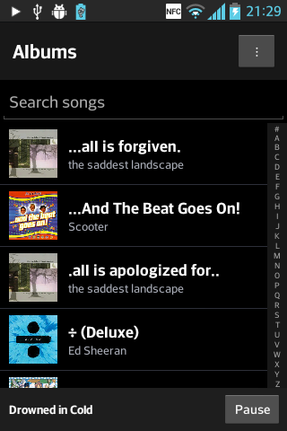
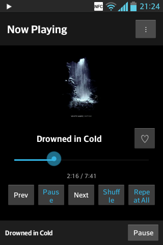
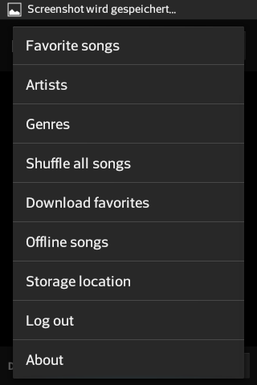

# JellyMusic Legacy

A Jellyfin music client for Android 4.0.3 and later (API 15+), designed around older phones and small screens.

[Download the latest release](https://github.com/DerAustistYT/jellymusic-legacy/releases/latest)

## Installation and connection

1. Download the APK from the release page and open it on your Android device. Enable installation from unknown sources in Settings → Security if prompted on older Android versions.
2. Enter your Jellyfin server address. HTTPS is added automatically if you omit the scheme; an explicit HTTP address is also accepted.
3. Choose **Connect with Quick Connect**, then approve the displayed code from **Settings → Quick Connect** in Jellyfin on another device. Quick Connect must be enabled on the server.

The app remembers the server and session locally. **Log out** clears the login session. Release builds use application ID `org.jellymusic.legacy` and install separately from earlier private builds with a different application ID.

## Features

### Library browsing

- Browse **Albums**, **Songs**, **Favorite songs**, **Artists**, and **Genres**.
- Open albums to see their tracks, or open an artist or genre to browse its songs.
- See cover artwork, track titles, and artist/album information.
- Search songs from the Albums screen using the keyboard's Search action.
- Browse large libraries in pages of 300 items with a **Load more** control.
- Use the **# / A–Z** sidebar on paged lists to jump through the library. Press or drag to preview a large letter, then release to load from that letter; **#** returns to the beginning.
- Pull down at the top of a list to refresh albums, songs, favorites, artists, genres, album tracks, search results, or the offline list.
- Browse and load artwork while playback continues. Artwork is cached in memory to reduce repeated downloads.

### Player and playback controls

- An integrated **Now Playing** screen with artwork, song title, elapsed time, total duration, and a seek bar.
- A persistent bottom mini-player; tap its song title to open Now Playing.
- **Play/pause**, **previous**, and **next** controls. Previous returns to the preceding queued song; at the beginning of the queue it restarts the current track.
- Tap a song to queue the currently loaded list and start at that song. Playback automatically advances through the remaining tracks.
- **Shuffle** rearranges the remaining queue while keeping the current song and playback history in place. Turning it off does not restore the previous order.
- **Shuffle all songs** loads the complete song library in batches and starts a shuffled queue.
- **Repeat off**, **Repeat 1**, and **Repeat All** modes.
- Add or remove the current song from Jellyfin favorites using the heart button.
- Background playback with the screen off, including automatic track transitions.
- A playback notification with the song title and **previous**, **play/pause**, and **next** buttons; tap it to reopen the app.
- Playback-start, progress, pause/resume, and stop reports to Jellyfin so the server dashboard can display the current listening session.

### Offline music and storage

- **Download favorites** saves favorite songs for offline playback, with progress and a downloaded/already-offline/failed summary.
- Existing downloaded files are skipped, and previously saved songs remain in the offline library.
- **Offline songs** lists and plays downloaded music, including when the server cannot be reached.
- When a saved session exists, the app opens the offline library at startup if there is no network connection. Connectivity failures during browsing also switch to offline songs.
- Offline songs are available from the menu even without an active login session.
- Choose **Internal storage** or a detected **SD card** for future downloads; the storage dialog shows available space.
- Changing storage affects future downloads. Existing downloads keep their saved paths and are not automatically moved.

### Interface

- A dark interface with blue accents and controls sized for older, small-screen Android devices.
- An overflow menu and support for the device's hardware Menu button.
- An **About** dialog with the app description.

## Codecs and built-in player

Playback uses Android's built-in **`MediaPlayer`** and the device's audio decoder. The app includes its own player UI; a separate music-player app is not required. Conscrypt supplies networking/TLS support, not audio decoding.

For online playback and offline downloads, the app requests **MP3** from Jellyfin's universal audio endpoint, with **192 kb/s**, a maximum of **two channels**, and a maximum sample rate of **44.1 kHz**. Jellyfin handles conversion when required, so the server must permit audio transcoding for source formats that need conversion. The client does not provide its own FLAC, AAC, Opus, or other software decoder, and the requested MP3 path is not a lossless playback mode.

Online tracks are downloaded in full into a temporary cache before playback starts. This can create a delay when starting or changing songs. The player skips leading ID3v2 tags to work around MP3 tag-parsing failures on older Android devices. Temporary playback files are removed after being handed to the player; **Download favorites** creates persistent offline copies.

## HTTPS support

The app bundles **Conscrypt 2.5.2** and installs its TLS provider and HTTPS socket factory at startup, allowing newer TLS connections on older Android devices. This applies to server API requests, cover artwork, and audio downloads.

Normal certificate and hostname validation remain enabled. HTTPS compatibility still depends on the server's TLS configuration and the certificate authorities trusted by the device; old Android trust stores can reject some certificate chains. If Conscrypt initialization fails, the app falls back to the device's existing HTTPS implementation. Explicit HTTP server URLs are supported, but traffic over HTTP is unencrypted.

## Current limits

- Playback queues contain the currently loaded list; **Load more** does not automatically extend an already started queue. Use **Shuffle all songs** to queue the complete library.
- Song search returns up to 100 results. An album's track list and a **Download favorites** batch each return up to 1,000 songs; favorite browsing itself is paginated.
- The Now Playing heart does not initially read the song's existing favorite state from the server. It starts as an outline for a newly selected track, even if that song is already a favorite.
- SD-card detection checks common legacy mount folders; availability depends on the device.
- Offline audio and track information are saved locally, but cover artwork is only cached in memory and may be unavailable without a connection.
- **Tested on an LG E610 (Optimus L5) running Android 4.0.3**, with music playback confirmed on the device. Compatibility on other Android versions and devices can vary. The published 1.0.0 APK also passed compilation, alignment, metadata, and signature checks.

## Screenshots

| Album library | Now Playing | App menu |
| --- | --- | --- |
|  |  |  |

## Build

Open this folder in Android Studio with **JDK 17** and **Android SDK 35** installed. Let Gradle sync, then build the debug APK. Alternatively, use **Gradle 8.9** with `gradle assembleDebug`.

The project uses Android Gradle Plugin 8.7.3, build tools 35.0.0, Java 8 source/target compatibility, minimum SDK 15, and target SDK 28. Conscrypt 2.5.2 is downloaded from Maven Central. Dependencies retain their respective licenses.

Local SDK paths, generated output, APKs, and signing keys are excluded from the source repository. A signed downloadable APK and SHA-256 checksum are provided on the release page.

## Privacy

Enter your own Jellyfin server address in the app. No personal server address, login credentials, or signing keys are included in this repository. The app stores its session and offline index locally and sends device identification and playback-session information to your configured Jellyfin server.

## AI assistance

OpenAI Codex and Anthropic Claude assisted with development and preparation of this project.
